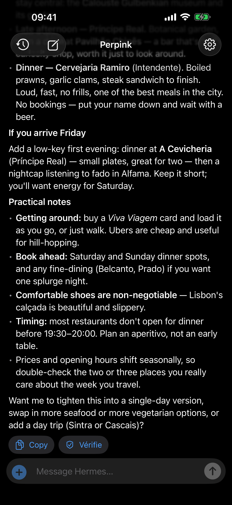
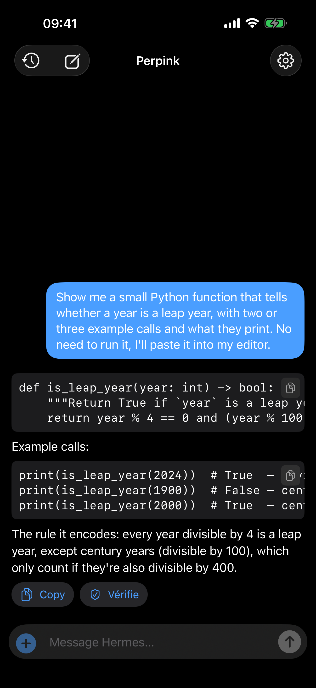
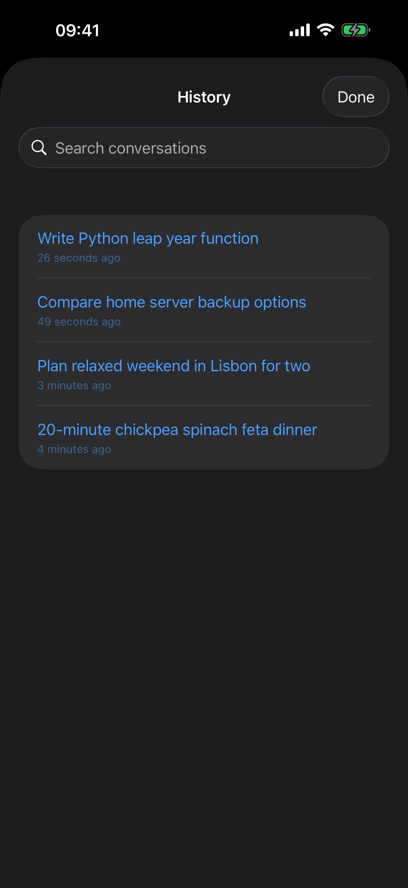
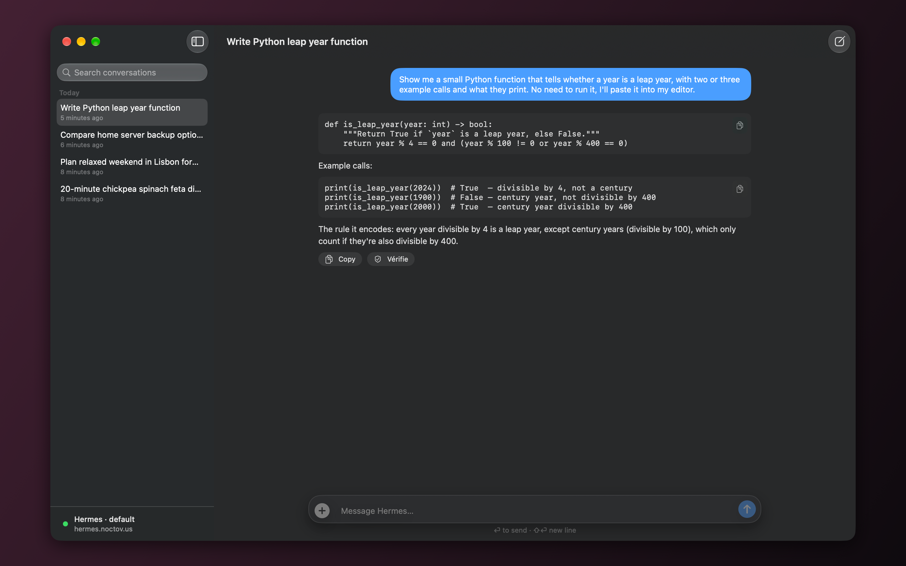

# Perpink

[](#getting-started)
[](https://www.swift.org)
[](https://developer.apple.com/xcode/swiftui/)
[](#layout)
[](https://hermes-agent.nousresearch.com/docs/)
[](LICENSE)

A native iOS and macOS client for a self-hosted [Hermes Agent](https://hermes-agent.nousresearch.com/docs/) — talk to your agent from a dedicated app, alongside Telegram, with the same memory and skills behind both.

SwiftUI, no dependencies. iOS 17+ and macOS 14+ from one target, Swift 6.

<p align="center">
  
  
  
</p>
<p align="center">
  
</p>

Perpink is a client only: it connects to a Hermes Agent instance you run yourself. It is an independent project, not affiliated with Nous Research, Tailscale or Hermès.

**Contents:** [Getting started](#getting-started) · [Features](#features) · [On the Mac](#on-the-mac) · [Limitations](#limitations) · [Server integration](#server-integration) · [Leaving mid-answer](#leaving-mid-answer) · [Layout](#layout) · [License](#license)

## Getting started

You need a running [Hermes Agent](https://hermes-agent.nousresearch.com/docs/) (any install: bare metal or the official Docker image), and a way for your iPhone or Mac to reach it — a [Tailscale](https://tailscale.com) (or Headscale) tailnet is the simplest.

### 1. Turn on Hermes's API server

The app talks to Hermes's [API server](https://hermes-agent.nousresearch.com/docs/user-guide/features/api-server), which is off by default. Add to Hermes's `.env` (`~/.hermes/.env`, or `/opt/data/.env` in the Docker image):

```sh
API_SERVER_ENABLED=true
API_SERVER_KEY=<a long random key: openssl rand -hex 32>
```

Restart the gateway (`hermes gateway`, or restart the container). Its log should say `[API Server] API server listening on http://127.0.0.1:8642`. Check it from the server:

```sh
curl -H "Authorization: Bearer <key>" http://127.0.0.1:8642/v1/models   # 200 and a model list
```

**In Docker**, the server must listen on the container's network, and the port should be published on the host's loopback only — never on a public interface:

```yaml
services:
  hermes:
    image: nousresearch/hermes-agent:<version>
    command: gateway run
    volumes:
      - ./data:/opt/data
    ports:
      - "127.0.0.1:8642:8642"   # loopback only; step 2 makes it reachable
```

with `API_SERVER_HOST=0.0.0.0` added to `data/.env` (inside the container, that only means "the container's own network").

> [!IMPORTANT]
> The key opens the agent with all its tools — on a default setup that includes running commands on the server. Make it long and random, keep it out of anything you share, and consider turning off the tools you won't use from the app: `hermes tools disable --platform api_server terminal file code_execution`.

### 2. Make it reachable from your devices

**With Tailscale (recommended).** Put the server and your devices on the same tailnet, then expose the port to the tailnet only, with HTTPS, from the server:

```sh
tailscale serve --bg 8642
```

The API is then at `https://<machine>.<tailnet>.ts.net` for every device on your tailnet and nowhere else (see [Tailscale Serve](https://tailscale.com/kb/1312/serve); the tailnet needs HTTPS certificates turned on). Plain HTTP over the tailnet works too — `http://<machine>.<tailnet>.ts.net:8642` with the API bound to the server's tailnet address — since WireGuard already encrypts the link; the app accepts both.

**On the internet.** Put an HTTPS reverse proxy (Caddy, nginx…) in front of the port. Two things matter: the answer streams as server-sent events, so turn off response buffering (`flush_interval -1` in Caddy, `proxy_buffering off` in nginx), and keep CDN proxies such as Cloudflare's out of the way — they cut long-lived streams after about 100 seconds. Never expose the API over plain HTTP on the internet.

### 3. Connect the app

Install Perpink, or build it: open `Perpink.xcodeproj` in Xcode, pick an iPhone, a simulator or **My Mac**, and run. Then open **Settings** (the gear on iPhone, ⌘, on the Mac):

- **Server** — the address from step 2, e.g. `https://hermes.example.ts.net` or `http://hermes.example.ts.net:8642`. Without a scheme, `http://` is assumed.
- **Profile** — leave it empty for the default profile, or enter a profile name (see [Profiles](#profiles)).
- **Key** — the profile's `API_SERVER_KEY`. It is kept in the Keychain.

**Test connection**, then ask away. To have these filled in on first launch of a build of your own, copy `Secrets.example.plist` to `Perpink/Secrets.plist` (gitignored) and fill it in; every value is optional, and anything in it is bundled into the app.

### Troubleshooting

| What you see | Likely cause |
| --- | --- |
| *Hermes refused the API key* | The key doesn't match — or it's the default profile's key on a named profile, which only accepts its own. |
| The connection times out | The device isn't on the tailnet, or in Docker the API still listens on `127.0.0.1` inside the container (`API_SERVER_HOST=0.0.0.0` is missing). |
| *HTTP 404* when testing | A misspelt profile name, or `gateway.multiplex_profiles` is off on the server. |
| Answers arrive all at once, or stop after a minute or two | A proxy is buffering or cutting the event stream; see step 2. |
| An image or file shows *Not available from this server* | Hermes doesn't serve the agent's files itself; see [Files the agent makes](#files-the-agent-makes). |

## Features

- **Streamed answers** from a Hermes *run*, with a live line underneath saying what the agent is doing — `Web Search · météo Genève` — while it works. Streamed text is applied on an 80ms timer rather than per chunk, since `MarkdownView` re-parses whatever it is handed.
- **Answers survive leaving the app.** Hermes runs the turn server-side and keeps going if the app is suspended or killed. Coming back finds the run and shows its answer — nothing is asked twice. See [Leaving mid-answer](#leaving-mid-answer).
- **History is Hermes's.** Conversations are Hermes sessions: the history sheet lists them from the server, and they show up in the Hermes dashboard and `hermes sessions` too. Swipe to delete, pull to refresh, search by title.
- **Profiles.** Point the app at any Hermes profile — each has its own memory, personality, tools and key. One profile per install.
- **Photos.** The + in the composer adds up to four photos from the library or the camera. Each is scaled to 1600 px and re-encoded as JPEG to fit Hermes's 10 MB request limit, then sent inline with the question. Hermes keeps text, not images, in its transcripts, so a reloaded conversation shows that a photo was there but not the photo itself.
- **Approvals.** When Hermes stops to ask before running a command, the app shows the command with the choices Hermes offers.
- **Stop** interrupts the run on the server, not just the stream.
- **Markdown rendering** by a hand-rolled renderer (`MarkdownView.swift`): headings, bold/italic/strikethrough/code, nested bullet and numbered lists (a list written as `1.` `1.` `1.` counts up), task lists, tables (also the ones written without the `|---|` row, when three or more lines split into the same columns), quotes, code blocks, and images — web images and `data:` URLs are shown inline.
- **The agent's files.** Charts and files the agent makes on its host come tagged `MEDIA:<path>`. Where the server hands them out (see [Files the agent makes](#files-the-agent-makes)), images show in the answer and other files — a CSV, a PDF — open in Quick Look, from where they can be shared. Elsewhere the file's name stays, marked as not available from that server.
- **Checking an answer.** The newest answer carries a **Vérifie** button next to Copy. It sends a follow-up turn asking Hermes to check what it just said against the web — search independent sources rather than trust its own answer, then say which claims hold up, which need correcting, and which it couldn't settle, with links. The prompt is deliberately blunt: asked merely to double-check, a model restates what it already said from memory instead of going to look. Only the last answer offers it, since that is the one the follow-up is about.
- **Copying out.** Every finished answer has a Copy button that puts its Markdown *source* on the pasteboard; code blocks carry their own button for just the snippet. Links open in an in-app Safari sheet.

## On the Mac

The same target builds a native Mac app (not Catalyst): pick **My Mac** as the run destination. The networking, runs, resuming and Markdown are shared as they are; what differs is the window around them.

- **History is a sidebar**, not a sheet: sessions grouped by Today / Yesterday / Previous 7 Days / Previous 30 Days / Older, searchable, deleted from the context menu or with ⌫. It refreshes itself when a run starts and ends.
- **Keys.** Return sends, Shift-Return starts a new line, Escape drops a quoted passage. ⌘N new chat, ⌘. stop, ⇧⌘V Vérifie, ⌘R refresh history, ⌘, Settings.
- **Settings** is the Mac's Settings window. A changed server, profile or key starts a new chat once typing pauses, since there is no sheet to close. The footer of the sidebar shows which Hermes the app is pointed at and whether it answered.
- **Photos** come from Photos, an open panel, or dragged onto the window. There's no camera.
- **Text size**: Settings has a Text Size slider for the conversation, and the View menu has Make Text Bigger ⌘1, Make Text Smaller ⌘− and Make Text Normal Size ⌘0 — Messages' wording, but ⌘1 rather than ⌘+, which takes Shift on a Swiss keyboard. SwiftUI on the Mac ignores `dynamicTypeSize`, so `TextSize.swift` rebuilds the text styles at a scaled point size. The sidebar and the buttons keep the system size. On iOS the conversation follows Dynamic Type, and the same setting can override it.
- **Links** open in the default browser, and the pointer turns into a pointing hand over them, as the HIG asks. Selectable text keeps its I-beam over SwiftUI's `pointerStyle(.link)`, so `MarkdownView` finds where links are drawn and sets the cursor itself.
- **Text** uses the system text styles, so body text is the Mac's 13pt and headings follow its scale.
- **Copy to quote** works as on iOS. AppKit has no clipboard-changed notification, so the change count is sampled every 0.4 s while the window is up.
- **One window**: the pending run on disk is the app's one in-flight run.

The Mac keychain is separate from the iPhone's: enter the profile's key once in Settings.

## Limitations

Perpink only ever *asks*: it opens a connection, sends a question and reads the answer. Nothing reaches it that it didn't ask for, which rules out a few things Telegram does.

- **No notifications.** The app registers for no push or local notifications, and Hermes's API server has no way to send any — a completion "never starts an unsolicited model turn", in its own docs. An answer that finishes while the app is closed is waiting when you come back to it, not announced.
- **Cron jobs don't come back to the app.** Hermes can't deliver a scheduled job to an API-server conversation: `deliver: origin` on a job created from the app falls back to the home channel (Telegram, say), and `api_server` is not a delivery target. Without a messaging platform, the output only lands in `~/.hermes/cron/output/` on the server. The same goes for anything the agent sends on its own initiative, such as a `send_message` to a channel.
- **Only the app's conversations.** The history lists sessions started through the API server (`source=api_server`); Telegram chats and cron runs live in the same Hermes but don't show up here.
- **Photos only.** Documents, PDFs and other files can't be sent — the API server accepts images inline and nothing else. Photos sent aren't kept in Hermes's transcripts either, so a reloaded conversation shows only that one was there.
- **The agent's files need a proxy.** Hermes doesn't serve the files it makes; without the small proxy in [Files the agent makes](#files-the-agent-makes), the app shows their names only.
- **One server and profile at a time.** Settings holds a single address, profile and key, with no list to pick from: switching means typing the other ones in.
- **One question at a time.** A new question waits for the current answer. Opening another conversation mid-answer stops the app following the run, not the run itself: it finishes on the server, and its answer is there when you come back to that conversation.

## Server integration

Everything the app calls is the documented [API server](https://hermes-agent.nousresearch.com/docs/user-guide/features/api-server):

| Endpoint | Purpose |
| --- | --- |
| `GET /api/sessions?source=api_server` | The history list. |
| `POST /api/sessions` | A new conversation, under an id the app picks (`perpink_…`), so a retried create lands on the same session. |
| `GET /api/sessions/{id}/messages` | A conversation's transcript. Tool rows are dropped; consecutive assistant rows read as one reply. |
| `DELETE /api/sessions/{id}` | Swipe to delete. |
| `POST /v1/runs` | A question, with `session_id` and an `Idempotency-Key`. With photos, `input` is one user message whose content is Chat Completions parts — `text`, then `image_url` with a `data:image/jpeg` URL. `/v1/runs` hands content to the agent unnormalized, and the Responses shape (`input_text`/`input_image`) reaches the model as neither. Photos also carry `instructions` (the run's ephemeral system layer) saying they exist only in the message: otherwise models reach for `vision_analyze` with an invented path and then search the disk for the file. |
| `GET /v1/runs/{id}/events` | The live answer: `message.delta`, `tool.started`, `approval.request`, `run.completed`… |
| `GET /v1/runs/{id}` | The run's status and output, when the live stream is gone. |
| `POST /v1/runs/{id}/stop`, `/approval` | Stop, and answering an approval. |
| `GET /files<path>` | A file the agent tagged `MEDIA:<path>`. Not Hermes's: see below. |

Why runs rather than `/api/sessions/{id}/chat/stream`: that endpoint interrupts the agent as soon as its client disconnects — which is what iOS suspending the app looks like. A run keeps going.

### Files the agent makes

When the agent makes a chart or a file, it writes it on its own host and puts `MEDIA:/opt/data/workspace/chart.png` in its answer. Telegram, Discord and the other adapters turn that tag into an attachment; the API server passes it through as text, and has no route to download the file.

So the app asks for `<server>[/p/<profile>]/files<path>`, with the profile's key, and a small proxy in front of Hermes answers it. Anything else goes through to Hermes untouched. A Caddy in front of the API port does both:

```caddy
:8642 {
	# Named profiles first: /p/<profile>/files/…, checked against that profile's key
	handle_path /p/<profile>/files/* {
		forward_auth hermes:8642 {
			uri /p/<profile>/v1/models
		}
		root * /srv/<profile>
		file_server {
			hide .*
		}
	}
	handle_path /files/* {
		forward_auth hermes:8642 {
			uri /v1/models
		}
		root * /srv/default
		file_server {
			hide .*
		}
	}
	handle {
		reverse_proxy hermes:8642 {
			flush_interval -1
		}
	}
}
```

- **The key is Hermes's to check.** `forward_auth` asks the profile's own `/v1/models` with the request's `Authorization` header, and only serves the file on a 2xx. No key is copied into the proxy, and a profile's key is refused on another profile's files, as on the rest of its API.
- **Each profile sees only its folders.** Mount, read-only, just the folders its files land in, at their path inside the Hermes container: `./data/workspace` at `/srv/default/opt/data/workspace`, `./data/cache/images` at `/srv/default/opt/data/cache/images`, and a named profile's `profiles/<name>/workspace` and `cache/images` under `/srv/<name>`. `.env`, `auth.json` and the session databases are never mounted, so no path reaches them.
- **No listing, no hidden files.** `file_server` lists nothing unless asked to, and `hide .*` leaves out dotfiles.
- **`flush_interval -1`** keeps the run events streaming instead of buffered.

Create a folder before mounting it, owned by the Hermes user (uid 10000 in the official image): Docker would otherwise create it as root, and Hermes could no longer write into it.

A server without the proxy answers `/files…` with an error, and the app shows the file's name instead.

### Profiles

With [`gateway.multiplex_profiles`](https://hermes-agent.nousresearch.com/docs/user-guide/multi-profile-gateways) on, one gateway serves every profile, and a named profile's API lives under `/p/<profile>/`. The app adds that prefix itself when **Profile** is set. Each profile answers only to its **own** `API_SERVER_KEY` (from `profiles/<name>/.env`) — the default profile's key is refused on `/p/<name>/`, and a profile with no key is unreachable. That is what makes it safe to hand someone a key for their own profile.

### Network

The API server is only reachable over the tailnet. In the container it listens on the bridge network (`API_SERVER_HOST=0.0.0.0` in `data/.env`; no published ports), and on the VPS a systemd socket on the tailnet address forwards port 8642 to the Caddy above, which proxies Hermes. Anyone using the app needs to be on the tailnet.

The link is plain HTTP: WireGuard already encrypts it, and Headscale issues no certificates. iOS and macOS block cleartext by default, so `Perpink-Info.plist` allows arbitrary loads: each user brings their own server, at whatever name or address it has. App Review asks for a justification of that exception.

### Adding a profile for someone else

In the container, as the `hermes` user (`sudo docker exec -it -u hermes hermes bash`):

```sh
hermes profile create <name> --description "…"
# Model and web search (a blank profile has neither), then its own personality:
hermes -p <name> config set model.provider openrouter
hermes -p <name> config set model.default <model>
hermes -p <name> config set web.search_backend searxng
hermes -p <name> config set web.extract_backend firecrawl
$EDITOR /opt/data/profiles/<name>/SOUL.md
# Its own secrets: OPENROUTER_API_KEY, SEARXNG_URL, FIRECRAWL_API_URL, and
# API_SERVER_KEY=$(openssl rand -hex 32) — the key that goes into their app.
$EDITOR /opt/data/profiles/<name>/.env
# No terminal, files or code on the API server for this profile:
hermes -p <name> tools disable --platform api_server terminal file code_execution browser cronjob delegation connections
```

Then, once, turn multiplexing on and restart: `hermes config set gateway.multiplex_profiles true`, then `sudo docker restart hermes` on the VPS. Profiles created later are picked up without a restart.

Avoid `--clone` for another person's profile: it copies your memory files (`USER.md` is about you), quick commands and the rest of your `.env`.

## App Store

`AppStore/metadata.json` holds the store's subtitle, promotional text and keywords per language, and `AppStore/description-fr.txt` and `AppStore/description-en.txt` the description, with the disclaimer: Perpink connects to your own Hermes Agent instance, typically over Tailscale, and is not affiliated with Nous Research, Tailscale or Hermès. The TestFlight description is the French one. `AppStore/site/` is the support page and privacy policy.

App Review can't join a tailnet, so it gets a separate, disposable Hermes instance behind HTTPS: its own data and Docker network, a spend-capped model key, and only the vision, memory, session-search and todo tools. The main instance is never exposed. Its key goes in the review details in App Store Connect, and it must be up while a build is in review. The store screenshots in `AppStore/screenshots/` come from that server's sample conversations: a Debug build launched with `-ScreenshotSession <id>` opens one (`-ScreenshotHistory YES` and `-ScreenshotSettings YES` open those sheets on iOS), and the Mac shots were taken from a build under the bundle id `us.noctov.perpink.screenshots`, which keeps its own settings and Keychain item.

## Leaving mid-answer

1. **A background-time assertion** (`BackgroundActivity`) keeps the live stream open for the grace period iOS grants a departing app.
2. **A record on disk** (`PendingRun`), written before the first request and cleared when the answer is on screen, holds the session id, the question, the run id, and the idempotency key it was started under.

On the way back in — a return to the foreground or a fresh launch — a leftover record is picked up. Every step is safe to repeat: the session is created under a known id, and restarting the run with the same idempotency key hands back the run that already exists. The app then follows it by polling `GET /v1/runs/{id}` (Hermes has one event queue per run, and a second listener next to a connection that died without saying so would split the events), and settles on its output. If Hermes has already forgotten the run, the answer is read out of the session transcript.

A connection that drops while the app is on screen is retried a few times before it is reported. A record older than six hours is dropped rather than resumed.

## Layout

| File | What's in it |
| --- | --- |
| `ChatView.swift` | iOS: the screen, its sheets and gestures, the history sheet. |
| `MacChatView.swift` | macOS: the split view, the session sidebar, the menu commands. |
| `ConversationViews.swift` | Shared: the thread, composer, message rows, approval card. |
| `Platform.swift` | `PlatformImage` and the background colors UIKit and AppKit name differently. |
| `ChatViewModel.swift` | Send / stop, following a run, resuming one, history. |
| `HermesClient.swift` | HTTP, the run-event stream, errors. |
| `Models.swift` | Wire types, run events, transcript → thread. |
| `PendingRun.swift` | The one in-flight run, on disk, so it outlives the process — photos included, byte for byte, since a repeated start must send the same body. |
| `PhotoAttachment.swift` | Scaling and encoding photos to send (ImageIO, both platforms); the iOS camera picker. |
| `BackgroundActivity.swift` | The background-time assertion that keeps a stream open off screen; on the Mac, keeping App Nap off it. |
| `SettingsStore.swift` | Server, profile and key; the profile URL prefix; the connection check. |
| `KeychainHelper.swift` | API key read/write. |

## License

Perpink is released under the [MIT License](LICENSE).
